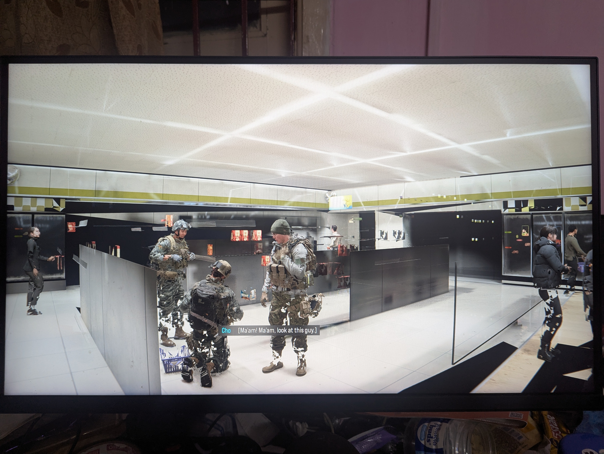

# MW4 D3D12 artifact workaround for Linux

A small, reversible helper for checking and applying a build-specific D3D12 DLL pair already present in a local game installation. It was tested on one Linux PC and is shared as a community workaround, not a guaranteed fix.

## What it does

- Checks for game build `25909941` and verifies the local source DLLs by SHA-256.
- Copies the verified pair from `game/game/runtime/` into `game/game/sp26/`.
- Backs up any destination files and records their hashes before replacing them.
- Restores the latest backup with `--rollback`.

It does not download, include, or redistribute game files. It does not edit `rex_sp.dll`, alter DRM or anti-cheat components, patch a running game process, or launch the game. Use a launch method already supported by your own installation.

## What the artifacts looked like

This photo was supplied by the repository maintainer and shows the rendering artifacts observed before applying the workaround:



The maintainer reported that the artifacts were absent after using the matching D3D12 DLL pair. There is no matching after-photo in this report, so this image documents the problem rather than serving as a before/after comparison.

## Requirements

- A local installation with the expected directory layout and build ID `25909941`.
- These two files in that installation's `game/game/runtime/` directory, matching the fingerprints below.
- A Linux system with Bash and the standard `sha256sum`, `grep`, `pgrep`, `awk`, `find`, `sort`, `head`, `cut`, `cp`, and `mv` utilities.

## Expected source DLL fingerprints

| File | SHA-256 |
| --- | --- |
| `d3d12.dll` | `633de512245b2b93728a283751f27bb44d199659830ec6fd9c78053f1feda2fe` |
| `d3d12core.dll` | `3822f59b19f18458762a7f680ce4395bb4bd98b6e873bd645d0c83ee20d3cb24` |

The script stops if the build ID or either source hash differs. A matching build ID alone does not guarantee identical files.

## Use

Clone the repository and make the script executable:

```bash
git clone https://github.com/Soldier0x0/mw4-patch-linux.git
cd mw4-patch-linux
chmod +x ./community-artifact-fix.sh
```

Check the files first. Replace the example path with the installation root, meaning the folder that contains `game/`:

```bash
./community-artifact-fix.sh --check --game-root "$HOME/path/to/game-installation"
```

If the build and hashes match, install the pair:

```bash
./community-artifact-fix.sh --install --game-root "$HOME/path/to/game-installation"
```

The script refuses to modify files while the game process is running. It saves backups and a manifest under `game/state/community-artifact-fix/`. After installation, launch the game with the method already supported by your installation and check the affected scene. If the artifacts are gone and the game behaves normally, leave the files in place; you do not need to run the fix again on each launch. If the result is worse, close the game and roll back:

```bash
./community-artifact-fix.sh --rollback --game-root "$HOME/path/to/game-installation"
```

For a specific backup, pass its directory before `--game-root`:

```bash
./community-artifact-fix.sh --rollback "/path/to/game/state/community-artifact-fix/backup-..." --game-root "$HOME/path/to/game-installation"
```

## Tested setup and observed results

- Zorin OS 18.1
- NVIDIA GeForce RTX 3060 12 GB, NVIDIA driver 595.99.02
- GE-Proton 11-9, UMU 1.4.4, Steam Runtime 4
- With ray tracing off, the game was smooth and the artifacts were absent during an observed session of about five minutes.
- With ray tracing on, the user reported severe lag and about 11.5 GB of NVIDIA GPU memory in use. This is GPU memory (VRAM), not system RAM. The observation does not prove the sole cause of the lag.

These results come from one PC. Other hardware, drivers, runtimes, game files, and settings may behave differently. This workaround does not claim to fix ray tracing performance, audio, or unrelated crashes. Ray tracing off is the only configuration in this report that was observed to run smoothly.

## Legal and safety notes

- This is an independent community project and is not affiliated with or endorsed by Activision, Microsoft, or any game publisher. Product names and trademarks belong to their respective owners and are used only to identify the relevant software.
- No game binaries are included or hosted here. Users must obtain and use their own game files and comply with the applicable software license and local law.
- The helper changes only the two named D3D12 files and keeps backups for rollback. Read the script before running it; do not run it with elevated privileges.
- The software is provided as-is, without warranty. The maintainer and contributors are not responsible for data loss, game instability, or other damage. Keep independent backups of important saves and files.
- The MIT License in this repository covers only the original helper scripts and documentation. It grants no rights to third-party software, game files, trademarks, or other copyrighted material.
